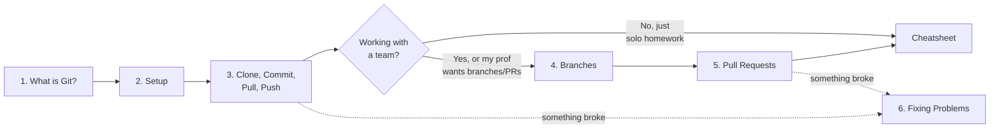

# Table of Contents

**Intro to Git & GitHub for CS Students:** the parts you actually need to get starter code, save your work, and turn it in.

> [!TIP]
> Every page starts with a **TL;DR** box. Skim that first, and open the **▶ Press for more detail** dropdowns only when you need them.

---

## Part 1: The Basics

| # | Page | Sections | Time |
|---|------|----------|------|
| 1 | [What Are Git & GitHub?](01-what-is-git-and-github.md) | Git vs. GitHub · The Big Picture · Words You'll Hear · Why Bother? | 5 min |
| 2 | [One-Time Setup](02-setup.md) | Create an Account · Install Git · Set Your Name & Email · Sign In So You Can Push | 10 min |
| 3 | [Clone, Commit, Pull, Push](03-clone-commit-pull-push.md) | `clone` · `status` · `add` · `commit` · `push` · `pull` · Putting It All Together · See Your History | 10 min |

## Part 2: Working With Others

| # | Page | Sections | Time |
|---|------|----------|------|
| 4 | [Branches](04-branches.md) | What Is a Branch? · The Branch Workflow · Commands · Naming Branches · Common Branch Issues | 8 min |
| 5 | [Pull Requests (PRs)](05-pull-requests.md) | Why "Pull" Request? · The PR Lifecycle · Step by Step · Group Project Workflow | 8 min |

## Part 3: Help & Reference

| # | Page | Sections | Time |
|---|------|----------|------|
| 6 | [Fixing Common Problems](06-fixing-common-problems.md) | Push Rejected · Merge Conflicts · Authentication Failed · Undoing Things · Not a Git Repository · Stuck in Vim · Committed a Password | 10 min |
| ⭐ | [**Cheatsheet**](cheatsheet.md) | Everyday Loop · Setup · Saving · Syncing · Branches · PR Flow · Undo · Error → Fix · Golden Rules | n/a |

---

## Which Pages Should I Read?



---

## In a Hurry? The 5 Commands You Need

```bash
git clone <repo-url>      # once: download the assignment
git pull                  # before you start working: get the latest version
git add .                 # stage your changes
git commit -m "message"   # save a snapshot
git push                  # upload to GitHub (usually how you "submit")
```

<details>
<summary><b>▶ Press for more detail</b></summary>

<br>

- `clone` only happens **once** per assignment. After that you just `cd` into the folder.
- `pull` → `add` → `commit` → `push` is the loop you repeat every time you work.
- Your work is **not on GitHub** until you `push`. Committing only saves it on *your* computer.
- Always double-check by opening your repo on github.com and making sure your latest changes are there.

Full explanation: [Clone, Commit, Pull, Push](03-clone-commit-pull-push.md)

</details>

---

## Not Covered (On Purpose)

GitHub Actions, CI/CD, GitHub Packages/GHCR, rebasing, submodules, and Git internals. You don't need them for coursework.
