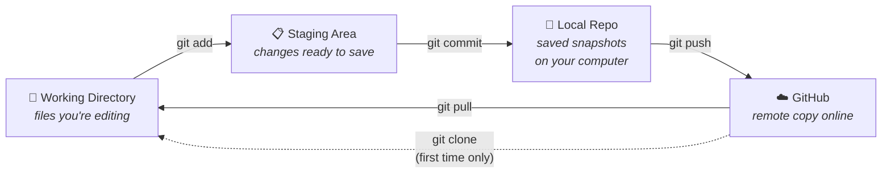

# 1. What Are Git & GitHub?

[← Contents](00-Table%20of%20Contents.md) · [Next: Setup →](02-setup.md)

> [!NOTE]
> **TL;DR**
> - **Git** is a program on your computer that saves snapshots (called **commits**) of your project.
> - **GitHub** is a website that stores a copy of your Git project online.
> - You **push** to upload your commits to GitHub and **pull** to download new ones.

---

## Git vs. GitHub

| | **Git** | **GitHub** |
|---|---|---|
| **What is it?** | A tool (a program) | A website / service |
| **Where does it live?** | On your computer | On the internet (github.com) |
| **What does it do?** | Tracks changes and saves snapshots | Stores your project online so others (like your professor) can see it |
| **Analogy** | Saving your game | Uploading your save to the cloud |

<b>▶ Press for more detail</b>

 

Git was created in 2005 and works completely offline. You can use Git without ever touching GitHub.

GitHub is one of several websites that host Git projects (others include GitLab and Bitbucket). Most CS courses use GitHub, often through **GitHub Classroom**, which automatically creates a private repo for each student when you accept an assignment link.

The reason you need both: Git keeps the history on your laptop, and GitHub is how your work gets to your professor, TA, or teammates.

---

## The Big Picture

Your code moves through **four places**. Learn this diagram and the rest of Git makes sense.

<b>▶ Press for more detail</b>

 

1. **Working Directory**: The normal folder on your computer. When you edit `main.py` in VS Code, you're changing the working directory.
2. **Staging Area**: A "waiting room" where you pick which changes go into the next snapshot. `git add` puts changes here.
3. **Local Repository**: The history of every snapshot (commit) you've made. It lives in a hidden `.git` folder inside your project. `git commit` saves here.
4. **Remote Repository (GitHub)**: The online copy. `git push` sends your commits here and `git pull` brings other people's commits down.

**Why have a staging area at all?** It lets you commit only *some* of your changes. For example, you could commit your finished function but not the debug file you're still messing with.

---

## Words You'll Hear

| Term | Plain-English meaning |
|---|---|
| **Repository (repo)** | A project folder that Git is tracking |
| **Commit** | A saved snapshot of your project, with a message describing what changed |
| **Remote** | The online copy of your repo (usually named `origin`) |
| **Clone** | Download a repo from GitHub to your computer for the first time |
| **Push** | Upload your commits to GitHub |
| **Pull** | Download new commits from GitHub |
| **Branch** | A separate line of work, so you can try things without breaking `main` |
| **`main`** | The default branch. Usually the "real" version of the project |
| **Merge** | Combine changes from one branch into another |
| **Pull Request (PR)** | A request on GitHub to merge your branch, where others can review it first |
| **Merge conflict** | When Git can't automatically combine two changes to the same lines |

<b>▶ Press for more detail: <code>origin</code> and <code>main</code></b>

 

- **`origin`** is just a nickname for "the GitHub URL I cloned from." When you see `git push origin main`, read it as *"push to GitHub, on the main branch."*
- **`main`** is the name of the default branch. Older repos (and older tutorials) may call it **`master`**. They mean the same thing, so use whichever one your repo has.

---

## Why Bother?

- ✅ **It's how you submit.** Many CS courses grade whatever is on GitHub at the deadline.
- ✅ **Undo button for your whole project.** Broke everything at 2 AM? Go back to a commit that worked.
- ✅ **Backup.** Laptop dies → your code is still on GitHub.
- ✅ **Teamwork.** Multiple people can work on the same project without emailing zip files.
- ✅ **Résumé.** Employers look at GitHub profiles.

---

## 🔗 Related

- [Clone, Commit, Pull, Push](03-clone-commit-pull-push.md): puts the big-picture diagram into practice
- [Branches](04-branches.md): what a branch actually looks like
- [Cheatsheet](cheatsheet.md): every command on one page

---

[← Contents](00-Table%20of%20Contents.md) · [Next: Setup →](02-setup.md)
