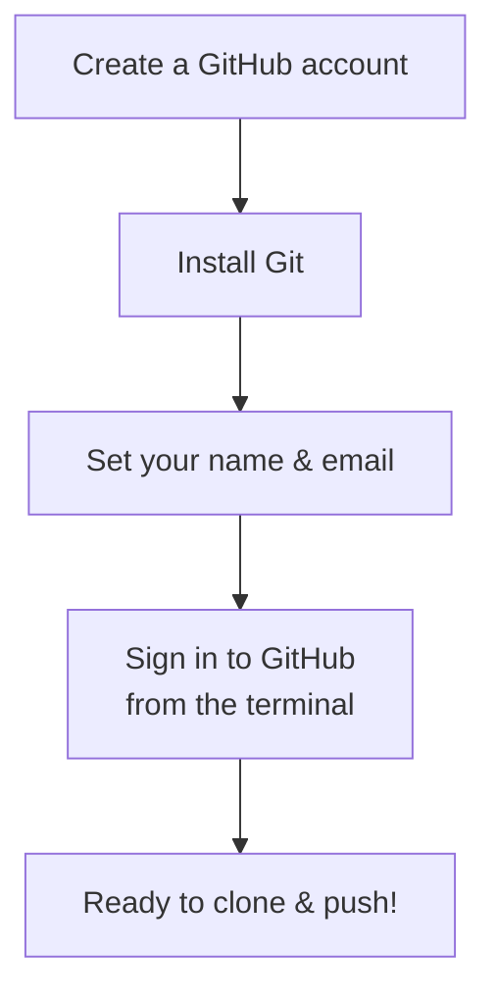

# 2. One-Time Setup

[← Previous: What is Git?](01-what-is-git-and-github.md) · [Contents](00-Table%20of%20Contents.md) · [Next: Clone, Commit, Pull, Push →](03-clone-commit-pull-push.md)

> [!NOTE]
> **TL;DR**: You only do this **once per computer**.
> 1. Make a GitHub account
> 2. Install Git
> 3. Tell Git your name and email
> 4. Sign in so you can push
>
> Already used Git before? Check what's done in [Already Set Up?](#already-set-up) and skip ahead.

---

## Already Set Up?

Used Git or GitHub before, maybe in another class or on an old laptop? Run these checks first and **skip any step that's already done**.

| Check | Run this | Already good if… |
|---|---|---|
| Git is installed | `git --version` | It prints a version number → skip [Step 2](#step-2-install-git). If it's **older than 2.28**, update Git anyway (some commands in this guide need it). |
| Git knows who you are | `git config --global --list` | It shows your `user.name` and `user.email` → skip [Step 3](#step-3-tell-git-who-you-are). Make sure the email **matches your GitHub account**. |
| You're signed in | `gh auth status` | It says `✓ Logged in to github.com account <your-username>` → skip [Step 4](#step-4-sign-in-so-you-can-push). Wrong username? See [Signed in with the wrong account?](#step-4-sign-in-so-you-can-push) below. |

> [!TIP]
> `gh: command not found` just means the GitHub CLI isn't installed yet. That's normal. Do Step 4.

---

## Setup Checklist



---

## Step 1: Create a GitHub Account

Go to [github.com](https://github.com) and sign up.

> [!TIP]
> Use a professional-ish username (e.g. `jsmith-dev`, not `xXpwn3rXx`). Employers may see it later.

<details>
<summary><b>▶ Press for more detail</b></summary>

<br>

- **Students get free perks.** Apply for the [GitHub Student Developer Pack](https://education.github.com/pack) with your school email.
- **Add your school email** to your GitHub account (Settings → Emails) so GitHub Classroom can match you to your class roster.
- **Turn on two-factor authentication (2FA).** GitHub requires it for most accounts now.
- **Already have an account?** Don't make a new one. Just sign in, add your school email (above), and turn on 2FA if it isn't on yet. Want a more professional username? Change it under **Settings → Account → Change username**. Your old repo links will redirect, but update anything you've shared.

</details>

---

## Step 2: Install Git

| Your computer | What to do |
|---|---|
| **Windows** | Download and run the installer from [git-scm.com](https://git-scm.com/downloads). Clicking "Next" through the defaults is fine. Use **Git Bash** as your terminal. |
| **Mac** | Open Terminal and run `xcode-select --install`, or install with [Homebrew](https://brew.sh): `brew install git` |
| **Linux** | `sudo apt install git` (Ubuntu/Debian) or `sudo dnf install git` (Fedora) |

**Check that it worked:**

```bash
git --version
# git version 2.x.x  ← any version number means you're good
```

<details>
<summary><b>▶ Press for more detail</b></summary>

<br>

- **"command not found"?** Close and reopen your terminal. If it still fails, the install didn't finish, so run the installer again.
- **Which terminal should I use?**
  - Windows: **Git Bash** (installed with Git) or the terminal inside VS Code
  - Mac: **Terminal** app or VS Code's terminal
- **VS Code users:** VS Code has Git built in (the Source Control tab on the left), but it still needs Git installed on your computer to work.

</details>

---

## Step 3: Tell Git Who You Are

Every commit is stamped with your name and email. Run these **once**, using your own info:

```bash
git config --global user.name "Your Name"
git config --global user.email "you@school.edu"
```

> [!IMPORTANT]
> Use the **same email** that's on your GitHub account. Otherwise your commits won't show up as yours on GitHub, and your professor may not be able to tell who did the work.

Optional but recommended:

```bash
git config --global init.defaultBranch main   # new repos use "main" instead of "master"
```

<details>
<summary><b>▶ Press for more detail</b></summary>

<br>

- `--global` means "for every repo on this computer." You won't need to do this again.
- Check your settings any time with:
  ```bash
  git config --global --list
  ```
- Made a typo? Just run the same command again with the fix.

</details>

---

## Step 4: Sign In So You Can Push

> [!WARNING]
> GitHub **does not accept your account password** in the terminal. If you type it in when pushing, it will fail. Pick **one** of the options below.

### Easiest Option: GitHub CLI

1. Install the GitHub CLI from [cli.github.com](https://cli.github.com) (Mac: `brew install gh`)
2. Run:
   ```bash
   gh auth login
   ```
3. Choose: **GitHub.com** → **HTTPS** → **Yes** (authenticate Git) → **Login with a web browser**
4. Copy the code it shows you, paste it into the browser, and click **Authorize**.

**✅ What success looks like.** Your terminal should end up looking roughly like this (the exact wording can change a little between versions):

```text
$ gh auth login
? Where do you use GitHub? GitHub.com
? What is your preferred protocol for Git operations on this host? HTTPS
? Authenticate Git with your GitHub credentials? Yes
? How would you like to authenticate GitHub CLI? Login with a web browser

! First copy your one-time code: ABCD-1234
Press Enter to open https://github.com/login/device in your browser...
✓ Authentication complete.
- gh config set -h github.com git_protocol https
✓ Configured git protocol
✓ Logged in as your-username
```

The line that matters is **`✓ Logged in as your-username`**. Double-check any time with:

```bash
gh auth status
# github.com
#   ✓ Logged in to github.com account your-username (keyring)
#   - Git operations protocol: https
```

<details>
<summary><b>▶ Press for more detail: signed in with the wrong (or an old) account?</b></summary>

<br>

If `gh auth status` shows a different username than the one your class uses (e.g. an old personal account instead of your school one):

```bash
gh auth logout
gh auth login     # sign in again, this time with the right account
```

If `git push` *still* uses the old account, your computer has an old password saved. See [Authentication Failed](06-fixing-common-problems.md#authentication-failed) for how to clear it on Mac and Windows.

</details>

<details>
<summary><b>▶ Press for more detail: other ways to sign in</b></summary>

<br>

**Option B: Git Credential Manager (Windows)**
If you installed Git for Windows with the default settings, you already have it. The first time you `git push`, a browser window pops up asking you to sign in to GitHub. Just sign in and you're set.

**Option C: Personal Access Token (works anywhere)**
1. On GitHub: **Settings → Developer settings → Personal access tokens → Tokens (classic) → Generate new token**
2. Check the **`repo`** box and set an expiration date (e.g. end of semester)
3. Copy the token (you will **only see it once**!)
4. When `git push` asks for a password, **paste the token** instead

**Option D: SSH keys**
More setup up front, but you never have to type anything again afterward. Follow GitHub's guide: [Connecting to GitHub with SSH](https://docs.github.com/en/authentication/connecting-to-github-with-ssh). If you use SSH, clone with the **SSH URL** (`git@github.com:...`) instead of the HTTPS one.

</details>

---

## Setup Done?

Run through this quickly:

- [ ] I can log in to github.com
- [ ] `git --version` prints a version number
- [ ] `git config --global user.name` prints my name
- [ ] `gh auth status` shows ✓ Logged in with **my** username (or I set up one of the other sign-in options)

---

## Related

- [What Are Git & GitHub?](01-what-is-git-and-github.md): why you're installing all this
- [Fixing Common Problems](06-fixing-common-problems.md): if signing in or pushing fails
- [Cheatsheet](cheatsheet.md): setup commands at a glance

---

[← Previous: What is Git?](01-what-is-git-and-github.md) · [Contents](00-Table%20of%20Contents.md) · [Next: Clone, Commit, Pull, Push →](03-clone-commit-pull-push.md)
