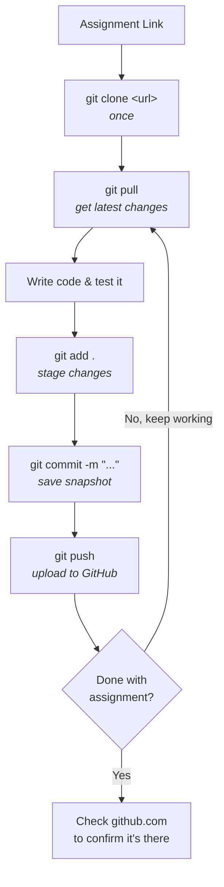
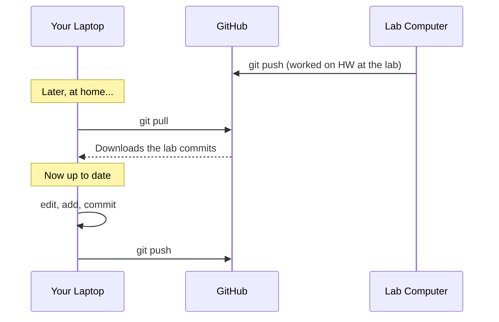

# 3. Clone, Commit, Pull, Push

[← Previous: Setup](02-setup.md) · [Contents](00-Table%20of%20Contents.md) · [Next: Branches →](04-branches.md)

> [!NOTE]
> **TL;DR: the assignment workflow**
> ```bash
> git clone <url>            # once
> cd <repo-folder>
> # ...every time you work:
> git pull
> # edit your code
> git add .
> git commit -m "What I did"
> git push                   # ← uploads to GitHub (usually how you submit)
> ```

---

## The Workflow at a Glance



---

## Step 1: Get the Repo (`git clone`)

**Do this once per assignment.**

1. Open the repo on GitHub (for GitHub Classroom, click the assignment link your professor gave you and press **Accept**).
2. Click the green **`<> Code`** button and copy the **HTTPS** URL.
3. In your terminal, go to where you keep your class work and clone:

```bash
cd ~/Documents/CS101                                    # go to your class folder
git clone https://github.com/your-class/hw1-yourname.git
cd hw1-yourname                                         # go INTO the repo folder
```

<details>
<summary><b>▶ Press for more detail</b></summary>

<br>

- `git clone` creates a **new folder** named after the repo. You must `cd` into it before running any other Git commands.
- **Don't clone inside another repo.** Keep each assignment in its own folder, side by side:
  ```
  CS101/
  ├── hw1-yourname/
  ├── hw2-yourname/
  └── project-yourname/
  ```
- **No starter repo? Starting from scratch?** Create a new repo on github.com (click **+** → **New repository**), then clone it the same way. That's much easier than running `git init` and connecting it yourself.
- **"Repository not found"?** You probably haven't accepted the assignment yet, or you're signed in to the wrong account.

</details>

---

## Step 2: Check What Changed (`git status`)

This is the **most useful command in Git.** Run it whenever you're unsure what's going on.

```bash
git status
```

```text
On branch main
Changes not staged for commit:
        modified:   main.py          ← you changed this file

Untracked files:
        helper.py                    ← brand-new file Git hasn't seen
```

<details>
<summary><b>▶ Press for more detail</b></summary>

<br>

| Status | Meaning | What to do |
|---|---|---|
| **Untracked** | New file Git isn't tracking yet | `git add` it if you want it saved |
| **Modified / not staged** | You changed a tracked file | `git add` it |
| **Staged / to be committed** | Ready to commit | `git commit` |
| **"nothing to commit, working tree clean"** | Everything's saved | 🎉 |
| **"Your branch is ahead of 'origin/main' by 2 commits"** | You committed but didn't push | `git push`! |

Want to see the exact lines you changed? Use:
```bash
git diff
```
Press `q` to exit the diff view.

</details>

---

## Step 3: Stage Your Changes (`git add`)

```bash
git add main.py          # stage one file
git add .                # stage EVERYTHING in this folder
```

<details>
<summary><b>▶ Press for more detail</b></summary>

<br>

- `git add .` is fine most of the time, but **run `git status` first** so you don't accidentally commit junk like:
  - compiled files (`.class`, `.o`, `.exe`, `__pycache__/`)
  - IDE folders (`.idea/`, `.vscode/`)
  - Mac's `.DS_Store`
  - giant datasets or anything with passwords/API keys
- To ignore those forever, create a file called **`.gitignore`** in your repo:
  ```gitignore
  # .gitignore
  .DS_Store
  __pycache__/
  *.class
  .idea/
  .vscode/
  ```
- Staged something by mistake? Unstage it (your file is **not** deleted):
  ```bash
  git restore --staged filename
  ```

</details>

---

## Step 4: Save a Snapshot (`git commit`)

```bash
git commit -m "Add input validation to calculator"
```

> [!TIP]
> **Commit early, commit often.** Every time something works, commit it. Small commits make it easy to go back if you break something.

<details>
<summary><b>▶ Press for more detail: writing good commit messages</b></summary>

<br>

Your professor might actually read these. Describe **what** you did:

| Bad | Good |
|---|---|
| `stuff` | `Add bubble sort implementation` |
| `fixed it` | `Fix off-by-one error in loop` |
| `asdfasdf` | `Add test cases for empty input` |
| `final final v2 REAL` | `Finish part 3 and clean up comments` |

**Forgot `-m`?** Git opens a text editor (often **Vim**). If you're stuck in Vim:
1. Press `i` to start typing
2. Type your message
3. Press `Esc`, then type `:wq` and press `Enter`

To make Git use something friendlier, like VS Code:
```bash
git config --global core.editor "code --wait"
```

</details>

---

## Step 5: Upload to GitHub (`git push`)

```bash
git push
```

> [!IMPORTANT]
> **Committing ≠ submitting.** Commits stay on your laptop until you `push`. After pushing, **refresh your repo on github.com** and make sure your changes are there.
>
> Pushing gets your work onto GitHub. For most GitHub assignments, that counts as submitting, but **check your syllabus**: some professors also want a Pull Request or a link turned in on Canvas (or wherever your class posts assignments).

<details>
<summary><b>▶ Press for more detail</b></summary>

<br>

- The full form is `git push origin main` ("push to GitHub, on the main branch"). Plain `git push` does the same thing when you cloned the repo.
- **Asked for a password and it fails?** GitHub doesn't accept account passwords here. See [Setup → Step 4](02-setup.md#step-4-sign-in-so-you-can-push).
- **"rejected… fetch first"?** Someone (or you, from another computer, or your professor) pushed changes you don't have. Run `git pull` and then `git push` again. More in [Fixing Common Problems](06-fixing-common-problems.md#push-rejected).
- **Deadline tip:** Most GitHub Classroom assignments grade whatever is pushed at the deadline. Push early, push often. Late pushes may be ignored.

</details>

---

## Step 6: Get the Latest Changes (`git pull`)

```bash
git pull
```

Run this **every time you sit down to work**, especially if:
- You work on more than one computer (laptop + lab computer)
- You're working with a partner
- Your professor might update the starter code

<details>
<summary><b>▶ Press for more detail</b></summary>

<br>

`git pull` does two things: it downloads new commits from GitHub, then merges them into your files.



**Pull before you start, not after you've made a bunch of changes.** That avoids most merge conflicts.

</details>

---

## Putting It All Together

A typical work session:

```bash
cd ~/Documents/CS101/hw1-yourname
git pull                              # 1. get latest

# ...write code, run it, test it...

git status                            # 2. see what changed
git add .                             # 3. stage
git commit -m "Implement part 2"      # 4. snapshot
git push                              # 5. upload
```

Then check github.com to confirm. 

---

## Bonus: See Your History

```bash
git log --oneline
```

```text
a1b2c3d Implement part 2
e4f5g6h Add input validation
9i8j7k6 Initial commit
```

<details>
<summary><b>▶ Press for more detail</b></summary>

<br>

- Each line is one commit: a short **ID** (hash) plus your message.
- `git log` without `--oneline` shows the author, date, and full message. Press `q` to exit.
- Want a visual version? `git log --oneline --graph --all`
- To undo changes or go back in time, see [Fixing Common Problems](06-fixing-common-problems.md).

</details>

---

## Related

- [What Are Git & GitHub?](01-what-is-git-and-github.md): the four places your code lives
- [Fixing Common Problems](06-fixing-common-problems.md): push rejected, merge conflicts, undoing commits
- [Cheatsheet](cheatsheet.md): the everyday loop

---

[← Previous: Setup](02-setup.md) · [Contents](00-Table%20of%20Contents.md) · [Next: Branches →](04-branches.md)
