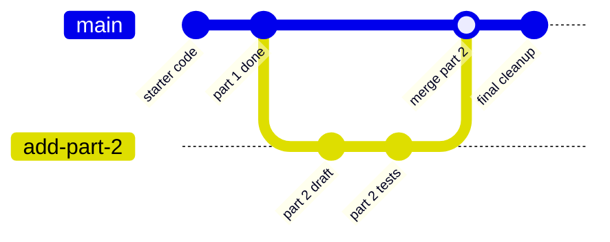
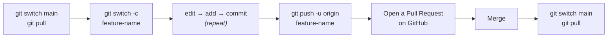

# 4. Branches

[← Previous: Clone, Commit, Pull, Push](03-clone-commit-pull-push.md) · [Contents](00-Table%20of%20Contents.md) · [Next: Pull Requests →](05-pull-requests.md)

> [!NOTE]
> **TL;DR**
> - A **branch** is a separate line of work where you can make changes without touching `main`.
> - Make one: `git switch -c my-branch`
> - Push it: `git push -u origin my-branch`
> - When it's done, merge it back with a [Pull Request](05-pull-requests.md).

---

## What Is a Branch?

Think of `main` as the **final draft**. A branch is a **scratch copy** where you can experiment. If it works, you merge it in. If it doesn't, you delete it, and `main` was never affected.



<details>
<summary><b>▶ Press for more detail</b></summary>

<br>

**When do students actually need branches?**

- **Group projects.** Each person works on their own branch so you don't overwrite each other.
- **Your professor requires PRs.** Some courses grade or review work through Pull Requests, and a PR always comes from a branch.
- **Trying something risky.** Want to rewrite your whole solution? Do it on a branch so you can bail out.

**When can you skip them?** Solo homework where your professor just says "push to main." That's fine!

Under the hood, a branch is just a label that points to a commit. Creating one is instant and doesn't copy any files, so don't be afraid to make them.

</details>

---

## The Branch Workflow



---

## Commands

### See your branches

```bash
git branch
```
```text
  add-login
* main          ← the * shows which branch you're on
```

### Create a new branch and switch to it

```bash
git switch -c add-login
```

> [!TIP]
> **Always start a new branch from an up-to-date `main`:**
> ```bash
> git switch main
> git pull
> git switch -c add-login
> ```

### Switch between branches

```bash
git switch main
git switch add-login
```

### Push a branch to GitHub (first time)

```bash
git push -u origin add-login
```

After the first time, plain `git push` works on that branch.

<details>
<summary><b>▶ Press for more detail: what does <code>-u</code> mean?</b></summary>

<br>

`-u` (short for `--set-upstream`) links your local branch to the branch on GitHub. You only need it **the first time** you push a new branch. After that, `git push` and `git pull` know where to go.

If you forget it, Git will print an error with the exact command to run. Just copy and paste it.

</details>

### Delete a branch (after it's merged)

```bash
git branch -d add-login
```

<details>
<summary><b>▶ Press for more detail</b></summary>

<br>

- `-d` only deletes the branch if it's been merged, so it's safe.
- `-D` (capital) force-deletes it even if it isn't merged. You'll lose any commits that exist only on that branch.
- You can't delete the branch you're currently on. Switch to `main` first.
- To delete it on GitHub too: `git push origin --delete add-login` (or click **Delete branch** after merging a PR).

</details>

---

## Naming Branches

Use short, lowercase names with dashes that describe the work:

| Good | Avoid |
|---|---|
| `add-login-page` | `branch1` |
| `fix-sorting-bug` | `my stuff` (spaces don't work) |
| `jsmith/part-3` | `asdf` |

---

## Common Branch Issues

<details>
<summary><b>▶ "I made changes on the wrong branch!"</b></summary>

<br>

If you **haven't committed yet**, just switch to (or create) the right branch. Your uncommitted changes come with you:

```bash
git switch -c the-right-branch
```

Then `add` and `commit` like normal.

</details>

<details>
<summary><b>▶ "Git won't let me switch branches"</b></summary>

<br>

```text
error: Your local changes to the following files would be overwritten by checkout
```

You have uncommitted changes that would clash with the other branch. Either:

- **Commit them** first: `git add . && git commit -m "WIP"`, or
- **Stash them** (set them aside temporarily):
  ```bash
  git stash          # hide changes
  git switch main    # now this works
  # ...later, back on the original branch:
  git stash pop      # bring the changes back
  ```

</details>

<details>
<summary><b>▶ "My files disappeared when I switched branches!"</b></summary>

<br>

Don't panic. They're on the other branch. Each branch has its own version of the files. Switch back and they'll reappear:

```bash
git switch the-other-branch
```

</details>

<details>
<summary><b>▶ "I see <code>git checkout</code> in other tutorials"</b></summary>

<br>

`git checkout` is the older command and still works:

| Older | Newer (this guide) |
|---|---|
| `git checkout main` | `git switch main` |
| `git checkout -b new-branch` | `git switch -c new-branch` |

Both do the same thing. `switch` is just clearer.

</details>

---

## Related

- [Pull Requests](05-pull-requests.md): how a branch gets merged back into main
- [Fixing Common Problems](06-fixing-common-problems.md): merge conflicts between branches
- [Cheatsheet](cheatsheet.md): branch commands

---

[← Previous: Clone, Commit, Pull, Push](03-clone-commit-pull-push.md) · [Contents](00-Table%20of%20Contents.md) · [Next: Pull Requests →](05-pull-requests.md)
