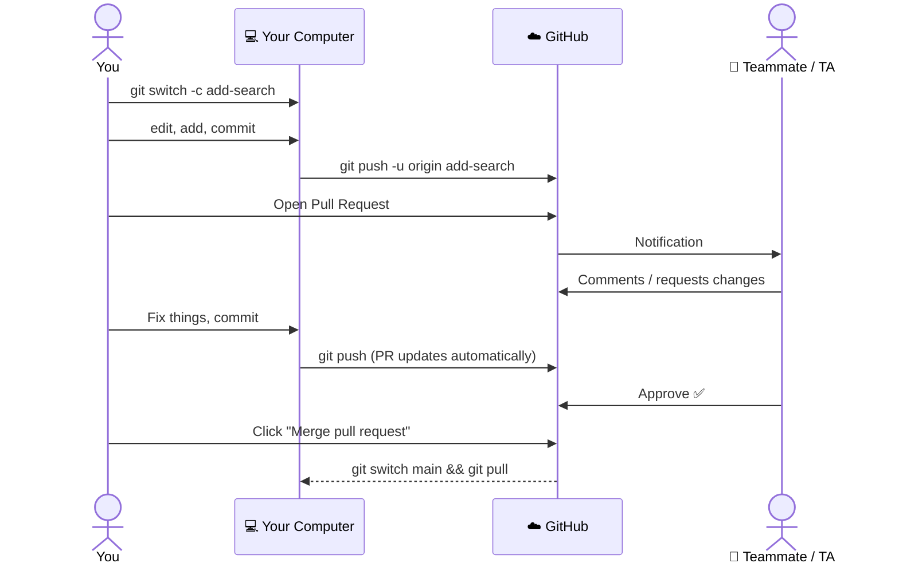
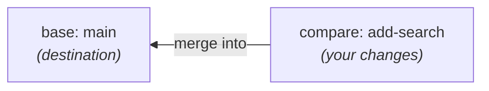
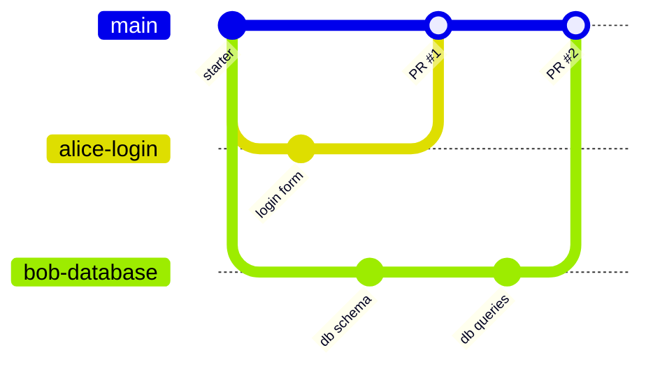

# 5. Pull Requests (PRs)

[← Previous: Branches](04-branches.md) · [Contents](00-Table%20of%20Contents.md) · [Next: Fixing Common Problems →](06-fixing-common-problems.md)

> [!NOTE]
> **TL;DR**
> - A **Pull Request** says: *"Here are the changes on my branch. Please review them and merge them into `main`."*
> - It happens **on the GitHub website**, not in the terminal.
> - Flow: **push branch → open PR → get review → merge → pull `main`**.

---

## Why "Pull" Request?

The name is confusing. You're asking the project to **pull your changes in**. Think of it as a **"merge request"** (which is literally what GitLab calls it).

PRs give your team (or TA) a place to:
- 👀 See exactly what changed, line by line
- 💬 Leave comments and suggestions
- ✅ Approve the changes before they hit `main`

---

## The PR Lifecycle



---

## Step by Step

### 1. Push your branch

```bash
git switch -c add-search
# ...make changes...
git add .
git commit -m "Add search feature"
git push -u origin add-search
```

### 2. Open the PR on GitHub

1. Go to your repo on github.com
2. You'll usually see a yellow banner: **"add-search had recent pushes"** → click **Compare & pull request**
   - No banner? Go to the **Pull requests** tab → **New pull request** → choose your branch
3. Make sure it says **base: `main`** ← **compare: `add-search`**
4. Write a title and description
5. Click **Create pull request**

<details>
<summary><b>▶ Press for more detail: what to write in a PR description</b></summary>

<br>

Keep it short. Answer these three questions:

```markdown
## What does this do?
Adds a search bar that filters the student list by name.

## How to test it
1. Run `python app.py`
2. Type "ali" in the search box
3. Only names containing "ali" should appear

## Notes
I wasn't sure how to handle uppercase. Currently it's case-insensitive.
```

**Tip:** In a group project, link the task or issue it's for, e.g. `Closes #4`. GitHub will auto-close issue #4 when the PR merges.

</details>

<details>
<summary><b>▶ Press for more detail: base vs. compare</b></summary>

<br>



- **base** = where the changes are **going** (usually `main`)
- **compare** = where the changes are **coming from** (your branch)

If the PR shows lots of changes you didn't make, you probably picked the wrong base branch.

</details>

### 3. Review & respond

Reviewers can comment on specific lines in the **Files changed** tab.

To make changes, **just commit and push to the same branch**. The PR updates automatically. Don't open a new PR.

```bash
# still on add-search
git add .
git commit -m "Handle uppercase in search"
git push
```

<details>
<summary><b>▶ Press for more detail: reviewing someone else's PR</b></summary>

<br>

1. Open the PR → **Files changed** tab
2. Hover over a line → click the blue **+** to comment on it
3. When finished, click **Review changes** (top right) and pick one:
   - 💬 **Comment**: general feedback
   - ✅ **Approve**: looks good to merge
   - 🔴 **Request changes**: needs fixes first

Be kind and specific: *"This loop might skip the last item. Should it be `<=`?"* beats *"this is wrong."*

</details>

### 4. Merge

Once it's approved (and there are no conflicts), click the green **Merge pull request** → **Confirm merge** button. Then click **Delete branch** to keep things tidy.

<details>
<summary><b>▶ Press for more detail: the three merge buttons</b></summary>

<br>

The dropdown next to the merge button offers:

| Option | What it does | When to use |
|---|---|---|
| **Create a merge commit** | Keeps all your commits plus a "merge" commit | Default. Fine for class |
| **Squash and merge** | Combines all your commits into one | When your branch has lots of messy "wip" commits |
| **Rebase and merge** | Replays your commits onto `main` | Skip this for now |

If your class or team doesn't specify, use the default.

**"This branch has conflicts that must be resolved"?** See [Merge Conflicts](06-fixing-common-problems.md#-merge-conflicts).

</details>

### 5. Update your local `main`

The merge happened on GitHub, so your computer doesn't know about it yet:

```bash
git switch main
git pull
git branch -d add-search    # clean up the local branch
```

---

## 🧑‍🤝‍🧑 Group Project Workflow



**Team rules that save friendships:**

1. 🚫 **Nobody pushes directly to `main`.** Everything goes through a PR.
2. 🔄 **`git pull` on `main` before starting a new branch.**
3. 🧩 **Split work by file or feature** so you're not all editing the same lines.
4. ⏱️ **Keep PRs small** and merge them often. A huge PR on the last night is a recipe for conflicts.
5. 👀 **Someone else reviews** before merging.

<details>
<summary><b>▶ Press for more detail: adding teammates to a repo</b></summary>

<br>

If you created the repo yourself (not via GitHub Classroom):

1. Repo → **Settings** → **Collaborators**
2. Click **Add people** and enter their GitHub username
3. They have to **accept the email invite** before they can push

With GitHub Classroom group assignments, the first teammate creates the team and the others join it when accepting the assignment link. Access is set up automatically.

**Optional:** To *force* PRs for everyone, go to **Settings → Branches → Add branch protection rule** for `main` and check **Require a pull request before merging**. (Private repos on free personal accounts may not support this. Classroom/org repos often do.)

</details>

---

## 🔗 Related

- [Branches](04-branches.md): every PR starts from a branch
- [Fixing Common Problems](06-fixing-common-problems.md): resolving conflicts in a PR
- [Cheatsheet](cheatsheet.md): the PR flow in 8 lines

---

[← Previous: Branches](04-branches.md) · [Contents](00-Table%20of%20Contents.md) · [Next: Fixing Common Problems →](06-fixing-common-problems.md)
