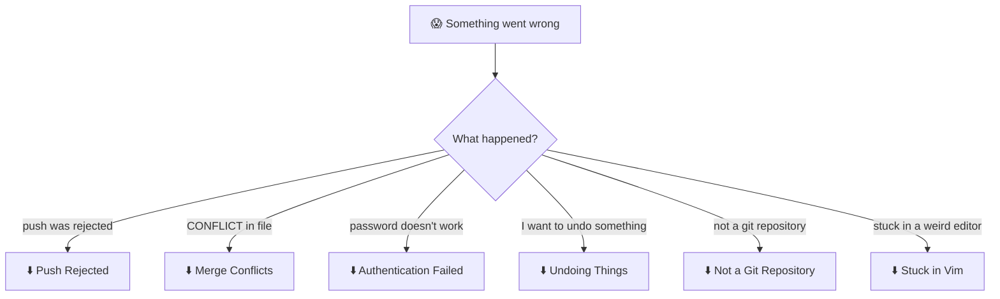
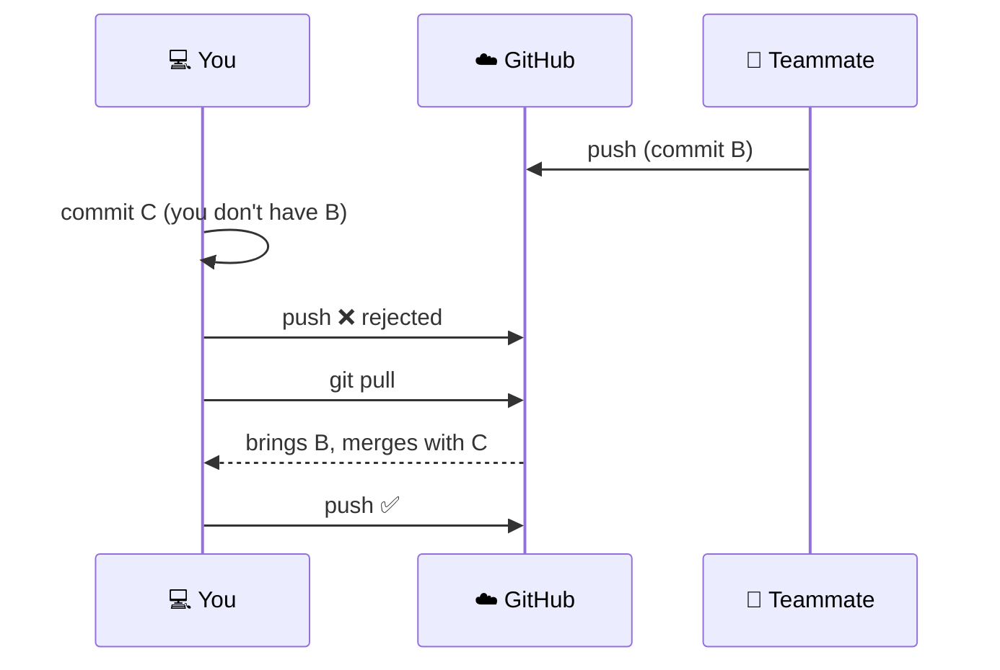

# 6. Fixing Common Problems

[← Previous: Pull Requests](05-pull-requests.md) · [Contents](00-Table%20of%20Contents.md) · [Cheatsheet →](cheatsheet.md)

> [!NOTE]
> **TL;DR**
> - **Step 1 is always `git status`.** It usually tells you what's wrong *and* what to do.
> - **Read the error message.** Git often prints the exact command to fix it.
> - **Don't delete the folder and re-clone** unless you've backed up your changes first.

---

## 🧭 Which Problem Do You Have?



---

## ⛔ Push Rejected

```text
! [rejected]        main -> main (fetch first)
error: failed to push some refs
hint: Updates were rejected because the remote contains work that you do not have locally.
```

**Why:** GitHub has commits you don't have yet (from a teammate, another computer, or your professor).

**Fix:**

```bash
git pull
git push
```

<details>
<summary><b>▶ Press for more detail</b></summary>

<br>



- If `git pull` says **CONFLICT**, see [Merge Conflicts](#-merge-conflicts) below.
- If `git pull` opens an editor asking for a merge message, just save and close it (see [Stuck in Vim](#-stuck-in-vim)).
- If `git pull` complains about **"divergent branches"**, run this once and then pull again:
  ```bash
  git config --global pull.rebase false
  ```
- ⚠️ **Never use `git push --force`** on a shared branch to "fix" this. It deletes other people's work on GitHub.

</details>

---

## 💥 Merge Conflicts

```text
CONFLICT (content): Merge conflict in main.py
Automatic merge failed; fix conflicts and then commit the result.
```

**Why:** You and someone else changed the **same lines** of the same file. Git doesn't know which version to keep, so it asks you.

**Fix in 4 steps:**

1. Open the file. You'll see markers like this:
   ```text
   <<<<<<< HEAD
   print("Hello from my version")
   =======
   print("Hello from their version")
   >>>>>>> main
   ```
2. **Edit it to what it *should* be**, and **delete all three marker lines** (`<<<<<<<`, `=======`, `>>>>>>>`):
   ```python
   print("Hello from my version")
   ```
3. Stage and commit:
   ```bash
   git add main.py
   git commit -m "Resolve merge conflict in main.py"
   ```
4. Push:
   ```bash
   git push
   ```

<details>
<summary><b>▶ Press for more detail</b></summary>

<br>

**Reading the markers:**

| Marker | Meaning |
|---|---|
| `<<<<<<< HEAD` | Start of **your** version |
| `=======` | Divider |
| `>>>>>>> branch-name` | End of **their** version |

You can keep yours, keep theirs, or **combine both**. Whatever makes the code correct.

**Use VS Code. It makes this much easier.** Conflicting files show clickable buttons: **Accept Current Change**, **Accept Incoming Change**, **Accept Both Changes**.

**Multiple files?** Run `git status`. Files listed under "both modified" still have conflicts. Fix each one, then `git add` them all.

**Panicking? Abort and go back to how things were before the merge:**
```bash
git merge --abort
```

**Conflict in a PR on GitHub?** GitHub may offer a **Resolve conflicts** button for simple cases. Otherwise, fix it locally:
```bash
git switch your-branch
git pull origin main      # brings main into your branch → conflicts appear
# fix the files, then:
git add .
git commit -m "Merge main and resolve conflicts"
git push                  # the PR updates and is now mergeable
```

**Avoid conflicts in the first place:** pull often, commit often, keep branches short-lived, and split work so teammates aren't editing the same lines.

</details>

---

## 🔑 Authentication Failed

```text
remote: Support for password authentication was removed on August 13, 2021.
fatal: Authentication failed
```

**Why:** GitHub doesn't accept your account password from the terminal.

**Fix:** Sign in with the GitHub CLI:

```bash
gh auth login
```

See [Setup → Step 4](02-setup.md#step-4-sign-in-so-you-can-push) for other options.

<details>
<summary><b>▶ Press for more detail</b></summary>

<br>

- **"Permission denied" or "Repository not found" (but the repo exists)?** You might be signed in as a different GitHub account (e.g. a personal one vs. a school one). Run `gh auth status` to check.
- **Mac keeps using an old saved password?** Open **Keychain Access**, search for `github.com`, delete the entry, then push again.
- **Windows keeps using an old one?** Open **Credential Manager** → **Windows Credentials**, remove the `git:https://github.com` entry, then push again.

</details>

---

## ↩️ Undoing Things

Find your situation:

| I want to… | Command | Safe? |
|---|---|---|
| Throw away changes to a file (not committed yet) | `git restore file.py` | ⚠️ Changes are gone for good |
| Unstage a file (undo `git add`) | `git restore --staged file.py` | ✅ File keeps your edits |
| Fix the message of my last commit (**not pushed yet**) | `git commit --amend -m "Better message"` | ✅ |
| Add a forgotten file to my last commit (**not pushed yet**) | `git add file.py` then `git commit --amend --no-edit` | ✅ |
| Undo my last commit but **keep the changes** (**not pushed yet**) | `git reset --soft HEAD~1` | ✅ |
| Undo a commit that's **already pushed** | `git revert <commit-id>` | ✅ Makes a new "undo" commit |
| Temporarily set changes aside | `git stash` / `git stash pop` | ✅ |

<details>
<summary><b>▶ Press for more detail</b></summary>

<br>

**The golden rule:** 🚨 **If you already pushed it, don't rewrite it.** Use `git revert` instead of `reset` or `--amend`. Rewriting pushed history causes problems for everyone else (and can mess up your submission history).

**Finding a commit ID** for `git revert`:
```bash
git log --oneline
# a1b2c3d Broke everything   ← this one
# e4f5g6h Working version
git revert a1b2c3d
```

**Look at an old version of a file without changing anything:**
```bash
git show e4f5g6h:main.py
```

**Restore one file to how it was in an old commit:**
```bash
git restore --source=e4f5g6h main.py
```

**"I really messed up and want to see everything I've done":** `git reflog` shows a history of everything HEAD has pointed to, even "lost" commits. It's a lifesaver, but ask a TA for help if you get here.

</details>

---

## 📂 Not a Git Repository

```text
fatal: not a git repository (or any of the parent directories): .git
```

**Why:** You're in the wrong folder.

**Fix:** `cd` into your repo folder (the one `git clone` created):

```bash
pwd                       # where am I?
ls                        # what's here?
cd hw1-yourname           # go into the repo
```

<details>
<summary><b>▶ Press for more detail</b></summary>

<br>

A common mistake is cloning, then forgetting to `cd` into the new folder. Another is opening the **parent** folder in VS Code instead of the repo folder itself.

In VS Code: **File → Open Folder** and pick the folder that contains the hidden `.git` folder.

</details>

---

## 📝 Stuck in Vim

You ran `git commit` or `git pull` and now your terminal shows a weird full-screen editor with `~` on every line.

**Fix:**
1. Press `Esc`
2. Type `:wq`
3. Press `Enter`

That saves and quits. (`:q!` quits **without** saving, which cancels the commit.)

<details>
<summary><b>▶ Press for more detail</b></summary>

<br>

- If it's a **commit** message editor, press `i` first, type your message, then `Esc` → `:wq` → `Enter`.
- If it's a **merge** message from `git pull`, the default message is fine, so just `:wq`.
- **Never want to see Vim again?** Set VS Code as your Git editor:
  ```bash
  git config --global core.editor "code --wait"
  ```
  Or use Nano, which shows its shortcuts at the bottom of the screen:
  ```bash
  git config --global core.editor "nano"
  ```

</details>

---

## 🔐 I Committed a Password or API Key

**Fix:**
1. **Change the password or revoke the key immediately.** Assume it's been seen.
2. Remove it from your code and use an environment variable or a config file listed in `.gitignore` instead.
3. Commit and push the fix.

<details>
<summary><b>▶ Press for more detail</b></summary>

<br>

Even after you delete it, the secret is still in your **commit history**, and anyone with access to the repo can find it. That's why rotating (changing) it is the real fix.

Completely scrubbing it from history is an advanced topic. Ask your TA or instructor for help if your repo is public.

**Prevent it:** put files like `.env` or `secrets.txt` in your `.gitignore` *before* you create them.

</details>

---

## 🆘 Still Stuck?

1. Run `git status` and **read it slowly**.
2. Copy the **exact** error message into a search engine.
3. **Before trying something drastic, back up your work** by copying your project folder somewhere else.
4. Ask a TA, and show them the output of `git status` and the full error.

---

## 🔗 Related

- [Clone, Commit, Pull, Push](03-clone-commit-pull-push.md): the normal workflow, to avoid most of these
- [Pull Requests](05-pull-requests.md): where conflicts usually show up
- [Cheatsheet](cheatsheet.md): error → fix table

---

[← Previous: Pull Requests](05-pull-requests.md) · [Contents](00-Table%20of%20Contents.md) · [Cheatsheet →](cheatsheet.md)
