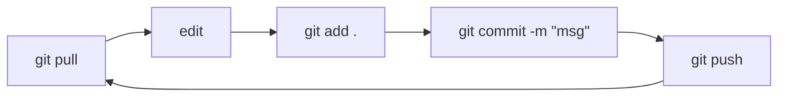

# Git & GitHub Cheatsheet

[← Contents](00-Table%20of%20Contents.md)

> [!TIP]
> Bookmark this page. Replace anything in `<angle-brackets>` with your own value, and leave out the brackets.

---

## The Everyday Loop

 Full guide: [Clone, Commit, Pull, Push](03-clone-commit-pull-push.md)



```bash
git pull
git add .
git commit -m "Describe what you did"
git push
```

---

## One-Time Setup

 Full guide: [One-Time Setup](02-setup.md)

| Command | What it does |
|---|---|
| `git --version` | Check that Git is installed |
| `git config --global user.name "<Your Name>"` | Set your name |
| `git config --global user.email "<you@school.edu>"` | Set your email (match your GitHub account!) |
| `git config --global init.defaultBranch main` | Name new default branches `main` |
| `git config --global core.editor "code --wait"` | Use VS Code instead of Vim |
| `git config --global pull.rebase false` | Make `git pull` merge (avoids the "divergent branches" error) |
| `gh auth login` | Sign in to GitHub so you can push |

---

## Getting a Repo

 Full guide: [Clone, Commit, Pull, Push](03-clone-commit-pull-push.md)

| Command | What it does |
|---|---|
| `git clone <url>` | Download a repo from GitHub (once) |
| `cd <repo-folder>` | Go into it. **Don't forget this!** |

---

## Saving Work

| Command | What it does |
|---|---|
| `git status` | **What's going on?** Run this constantly |
| `git diff` | Show exact line changes (press `q` to exit) |
| `git add <file>` | Stage one file |
| `git add .` | Stage everything |
| `git commit -m "<message>"` | Save a snapshot |
| `git log --oneline` | Show commit history |

---

## Syncing with GitHub

| Command | What it does |
|---|---|
| `git pull` | Download and merge new changes |
| `git push` | Upload your commits to GitHub (**usually how you submit**) |
| `git push -u origin <branch>` | Push a new branch for the first time |

---

## Branches

 Full guide: [Branches](04-branches.md)

| Command | What it does |
|---|---|
| `git branch` | List branches (`*` = current) |
| `git switch -c <branch>` | Create a branch and switch to it |
| `git switch <branch>` | Switch to an existing branch |
| `git switch main` | Go back to main |
| `git branch -d <branch>` | Delete a merged branch |
| `git merge <branch>` | Merge `<branch>` into the branch you're on |

---

## Pull Request Flow

 Full guide: [Pull Requests](05-pull-requests.md)

```bash
git switch main && git pull              # 1. start fresh
git switch -c <branch>                   # 2. new branch
# ...edit, add, commit...                # 3. do the work
git push -u origin <branch>              # 4. push it
# → open PR on github.com                # 5. "Compare & pull request"
# → review → Merge pull request          # 6. merge on GitHub
git switch main && git pull              # 7. update local main
git branch -d <branch>                   # 8. clean up
```

---

## Undo

 Full guide: [Fixing Common Problems](06-fixing-common-problems.md)

| Situation | Command |
|---|---|
| Unstage a file | `git restore --staged <file>` |
| Discard uncommitted changes to a file | `git restore <file>` |
| Fix last commit message *(not pushed)* | `git commit --amend -m "<new msg>"` |
| Undo last commit, keep changes *(not pushed)* | `git reset --soft HEAD~1` |
| Undo a **pushed** commit | `git revert <commit-id>` |
| Set changes aside / bring them back | `git stash` / `git stash pop` |
| Cancel a merge with conflicts | `git merge --abort` |

---

## Error → Fix

Full guide: [Fixing Common Problems](06-fixing-common-problems.md)

| You see… | Do this |
|---|---|
| `rejected … (fetch first)` | `git pull` then `git push` |
| `CONFLICT … Merge conflict in <file>` | Edit the file, remove the `<<<<<<<` `=======` `>>>>>>>` lines, then `git add .` → `git commit` → `git push` |
| `Authentication failed` | `gh auth login` |
| `not a git repository` | `cd` into your repo folder |
| `has no upstream branch` | `git push -u origin <branch>` |
| `Your local changes would be overwritten` | `git stash` (or commit first), then retry |
| `divergent branches` | `git config --global pull.rebase false`, then `git pull` |
| Stuck in Vim | `Esc` → `:wq` → `Enter` |

---

## Golden Rules

1. **`git status` is your best friend.**
2. **Pull before you start working.**
3. **Commit small and often, with real messages.**
4. **Committing is not submitting. Push!** Then check github.com.
5. **Never `git push --force`** on shared branches.
6. **Use a `.gitignore`** and never commit passwords or keys.

<details>
<summary><b>▶ Press for more detail: starter <code>.gitignore</code></b></summary>

<br>

Create a file named `.gitignore` in the top folder of your repo:

```gitignore
# OS junk
.DS_Store
Thumbs.db

# Editors
.vscode/
.idea/

# Python
__pycache__/
*.pyc
venv/
.venv/

# Java
*.class
bin/
out/
target/

# C / C++
*.o
*.out
*.exe

# Node
node_modules/

# Secrets
.env
```

Already committed a file you want ignored? Remove it from Git (but keep it on disk):
```bash
git rm --cached <file>
git commit -m "Stop tracking <file>"
```

</details>

---

[← Contents](00-Table%20of%20Contents.md)
